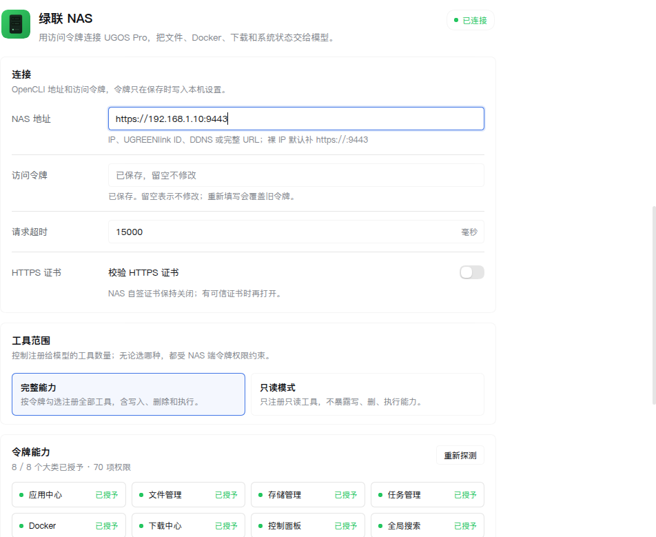

<p align="center"></p>

# dsh-ugreen-nas

在 DeepSeek Harness 里直接管理绿联 NAS：文件、Docker、下载、应用、存储和系统状态，全部变成对话里能调的工具。

## 特点

- **覆盖完整**：59 个工具覆盖 UGOS Pro 访问令牌的全部 70 项权限（8 个大类），连服务端流式的应用安装/卸载/更新和全局搜索也支持。
- **权限即边界**：用 NAS 控制面板签发的「访问令牌」连接，不碰账号密码、不走 SSH；令牌没勾的能力，对应工具直接不注册。
- **只读开关**：`mode=readonly` 一键只保留只读工具；删除、卸载、停机类操作带【写/危险操作】标注，逐步确认交给 DSH 的工具审批。
- **状态可见**：设置页实时显示 8 个大类的「已授予 / 未授予」，一键重新探测。



## 快速开始

1. 在 NAS「控制面板 → 账号 → 访问令牌」创建令牌，按需勾选权限。
2. 安装插件：

   ```bash
   dsh plugin --profile web add dsh-ugreen-nas   # npm 包，推荐
   ```

   或从源码装：clone 本仓库 → `npm install && bash scripts/build.sh` → 插件管理页选本地目录。
3. 「设置 → 插件 → 绿联 NAS」填入 NAS 地址和访问令牌，保存后点「测试连接」。

| 配置 | 默认 | 说明 |
|---|---|---|
| endpoint | — | NAS 地址；裸 IP 自动补 https://:9443，也支持 UGREENlink / DDNS |
| accessToken | — | 访问令牌（ugpoa_v1 开头），只存在本机设置，不回显 |
| mode | full | full 注册全部工具；readonly 只注册只读工具 |
| timeoutMs | 15000 | 单次请求超时（毫秒） |
| rejectUnauthorized | false | 自签证书保持关闭 |

## 能做什么

| 大类 | 典型操作 |
|---|---|
| 文件 | 读写文件、建目录、复制/移动/改名/删除、回收站恢复、标签、配额 |
| Docker | 容器启停与日志、Compose 项目全生命周期、镜像搜索与拉取、端口/目录/独显占用检查 |
| 下载 | HTTP 下载任务的创建、暂停、恢复、重试、移除 |
| 应用 | 应用中心的安装/卸载/更新、启动/停用 |
| 存储 | 磁盘、存储池、卷状态，S.M.A.R.T. 健康诊断 |
| 任务 | CPU/内存/GPU/网络/磁盘/卷实时指标，服务与进程占用 |
| 控制面板 | 系统版本、网络配置、硬件（风扇/UPS）、账号与用户组 |
| 全局搜索 | 按名称、类型、大小、时间全盘搜文件 |

<details>
<summary>全部 59 个工具名</summary>

| 大类 | 工具 |
|---|---|
| 连接 | ugreen_connection_test |
| 文件 | ugreen_file_stat · list · read · write · mkdir · share_mkdir · rename · move · delete · restore · chtimes · tag_set · tag_link · tag_list · tag_delete · quota（均带 ugreen_ 前缀） |
| 存储 | ugreen_storage_info · ugreen_storage_smart |
| 任务 | ugreen_task_overview · ugreen_task_metrics |
| 应用 | ugreen_app_status · list · install · uninstall · update · start · stop（均带 ugreen_ 前缀） |
| Docker | ugreen_docker_list · logs · start · stop · restart · compose_list · compose_logs · compose_create · compose_start · compose_stop · compose_restart · compose_delete · image_search · image_list · image_pull · app_usage · app_rebuild · check |
| 下载 | ugreen_download_list · create · pause · resume · retry · remove（均带 ugreen_ 前缀） |
| 控制面板 | ugreen_system_info · user_list · user_create · group_add_members · hardware_info · network_info |
| 全局搜索 | ugreen_search |

</details>

## 权限怎么算

- NAS 端令牌按 8 个大类勾选，共 70 项小类。插件激活时逐大类探测一次：没授予的大类不注册工具；细到单项的校验在 NAS 端，比如同一大类勾了删除没勾写入，调用时会返回 403 并指名缺哪项。
- 改权限要在 NAS 端重建令牌，插件侧重新探测即可，不用改配置。
- 70 项明细见文末附录。

## 安全

- 访问令牌等于它勾选的权限：日常建议只勾 read（只读令牌），需要写操作再单独签发。
- 令牌只存在本机插件设置里（secret 字段），不要写进代码、日志或对话。
- Files 权限按账号授权，不支持按文件夹限权：勾了 Files 的 read，令牌就能读到该账号可见的所有文件。
- NAS 用自签证书时保持「校验 HTTPS 证书」关闭；换可信证书后再打开。

## 文档

- 协议逆向与流式帧格式、protobuf 提取方法：[docs/ugreen-opencli-protocol.md](docs/ugreen-opencli-protocol.md)
- 开发：`npm install && bash scripts/build.sh`，回归 `npm test`（冒烟 + 离线单元测试）

## 附录

<details>
<summary>70 项权限总表</summary>

UGOS Pro 的访问令牌按 8 个官方应用分成 8 个大类，创建令牌时按大类勾选：

| 大类（应用） | 小计 | read | write | execute | delete |
|---|---:|---:|---:|---:|---:|
| App Center（应用中心） | 7 | 2 | 2 | 2 | 1 |
| Control Panel（控制面板） | 8 | 6 | 2 | 0 | 0 |
| Files（文件管理） | 15 | 4 | 8 | 1 | 2 |
| Universal Search（全局搜索） | 1 | 1 | 0 | 0 | 0 |
| Storage（存储管理） | 4 | 4 | 0 | 0 | 0 |
| Task Manager（任务管理器） | 9 | 9 | 0 | 0 | 0 |
| Docker | 20 | 10 | 2 | 7 | 1 |
| Downloads（下载中心） | 6 | 1 | 4 | 0 | 1 |
| **合计** | **70** | **37** | **18** | **10** | **5** |

<details>
<summary>70 项逐条明细</summary>

| 大类 | 权限 | 操作 | 说明 |
|---|---|---|---|
| App Center | app_detail | read | 查看应用、版本与运行状态 |
| App Center | app_search_and_available_updates | read | 搜索应用与可用更新 |
| App Center | app_install_stream | write | 安装指定应用 |
| App Center | app_uninstall_stream | delete | 卸载指定应用 |
| App Center | app_update_stream | write | 更新指定应用 |
| App Center | app_stop | execute | 停用指定应用 |
| App Center | app_start | execute | 启动指定应用 |
| Control Panel | ctl_user_group_list | read | 查看账号与用户组列表 |
| Control Panel | ctl_user_create | write | 创建普通账号并设置密码 |
| Control Panel | ctl_group_add_members | write | 向用户组添加成员 |
| Control Panel | ctl_hardware_power | read | 查看风扇/电源/UPS 等硬件设置 |
| Control Panel | ctl_os_identity | read | 查看设备型号与系统版本 |
| Control Panel | ctl_os_update_status | read | 查询系统更新状态与可用版本 |
| Control Panel | ctl_network_general | read | 查看网关、DNS、代理等通用网络配置 |
| Control Panel | ctl_network_connection | read | 查看网卡状态与 IP 配置 |
| Files | filemgr_list_and_attr | read | 浏览文件列表与属性 |
| Files | filemgr_read_and_download | read | 读取与下载文件内容 |
| Files | filemgr_upload | write | 上传文件 |
| Files | filemgr_create_dir | write | 新建文件夹 |
| Files | filemgr_create_share_dir | write | 新建共享文件夹 |
| Files | filemgr_chtimes | write | 修改文件或目录时间戳 |
| Files | filemgr_cp_move_path | write | 复制或移动文件 |
| Files | filemgr_rename | write | 重命名文件 |
| Files | filemgr_delete | delete | 删除文件 |
| Files | filemgr_recover_from_recycle | write | 从回收站恢复文件 |
| Files | filemgr_get_quota | read | 查询空间配额 |
| Files | filemgr_set_quota | execute | 设置空间配额 |
| Files | filemgr_get_tag | read | 获取标签信息 |
| Files | filemgr_add_tag | write | 添加或设置标签 |
| Files | filemgr_delete_tag | delete | 删除标签 |
| Universal Search | title_search_task | read | 按名称/类型/大小/时间搜索文件 |
| Storage | storage.disk.list | read | 查看内部磁盘列表 |
| Storage | storage.pool.list | read | 查看存储池列表 |
| Storage | storage.disk.smart.all | read | 读取所有硬盘 S.M.A.R.T. 诊断 |
| Storage | storage.volume.list | read | 查看卷列表 |
| Task Manager | taskmgr_get_run_overview | read | 查看 CPU/内存/风扇/网络/磁盘总览 |
| Task Manager | taskmgr_get_cpu_metric | read | 查看 CPU 占用与温度 |
| Task Manager | taskmgr_get_gpu_metric | read | 查看 GPU 占用 |
| Task Manager | taskmgr_get_mem_metric | read | 查看内存占用 |
| Task Manager | taskmgr_get_net_traffic | read | 查看网络收发速率 |
| Task Manager | taskmgr_get_disk_metric | read | 查看硬盘读写速率 |
| Task Manager | taskmgr_get_volume_metric | read | 查看卷读写速率 |
| Task Manager | taskmgr_get_service_resource | read | 查看各服务资源占用 |
| Task Manager | taskmgr_get_process_resource | read | 查看各进程资源占用 |
| Docker | docker_image_search | read | 在镜像仓库搜索镜像 |
| Docker | docker_image_list | read | 查看本地镜像 |
| Docker | docker_image_pull | write | 拉取指定镜像 |
| Docker | docker_container_list | read | 查看容器与运行状态 |
| Docker | docker_container_start | execute | 启动容器 |
| Docker | docker_container_stop | execute | 停止容器 |
| Docker | docker_container_restart | execute | 重启容器 |
| Docker | docker_container_logs | read | 查看容器日志 |
| Docker | docker_compose_project_create | write | 创建 Compose 项目 |
| Docker | docker_compose_project_list | read | 查看 Compose 项目 |
| Docker | docker_compose_project_logs | read | 查看 Compose 项目日志 |
| Docker | docker_compose_project_start | execute | 启动 Compose 项目 |
| Docker | docker_compose_project_stop | execute | 停止 Compose 项目 |
| Docker | docker_compose_project_restart | execute | 重启 Compose 项目 |
| Docker | docker_compose_project_delete | delete | 删除 Compose 项目及容器 |
| Docker | docker_app_discrete_gpu_check | read | 检查容器应用的独显占用 |
| Docker | docker_container_port_check | read | 检查容器端口占用 |
| Docker | docker_container_directory_check | read | 检查容器目录占用 |
| Docker | docker_app_usage | read | 查看容器应用资源占用 |
| Docker | docker_app_rebuild | execute | 按配置强制重建容器应用 |
| Downloads | download_task_create | write | 从链接或种子创建下载任务 |
| Downloads | download_task_get | read | 查看下载任务状态与进度 |
| Downloads | download_task_pause | write | 暂停下载任务 |
| Downloads | download_task_resume | write | 恢复下载任务 |
| Downloads | download_task_retry_failed | write | 重试失败的下载任务 |
| Downloads | download_task_remove | delete | 移除下载任务（保留文件） |

</details>
</details>
