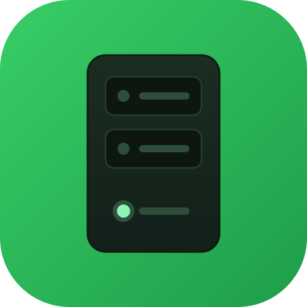

# dsh-ugreen-nas

[English](#english) | 中文

DeepSeek Harness 插件：通过 UGOS Pro 访问令牌连接绿联 NAS，让模型直接管理文件、Docker、下载和应用，并查看系统状态。无需 NAS 账号密码，不走 SSH。

## 主要能力

- **60 个工具，覆盖 8 大类 70 项权限**：文件、Docker/Compose、下载、应用中心、存储、任务监控、控制面板与全局搜索。
- **权限即边界**：按 NAS 访问令牌授予的大类注册工具；未授予的能力不会暴露给模型。
- **安全默认**：写、删、执行操作默认经 DSH 审批；完全权限档（`approval: never`）下 DSH 会直接拒绝、不弹窗。
- **可控范围**：`allowedRoots` 目录白名单、`mode=readonly` 只读模式、`accessLevel=user` 普通用户模式。
- **状态可见**：设置页按需探测令牌权限，显示已授予/未授予，并支持解除绑定。

## 安装

1. 创建访问令牌：打开手机「绿联云」App → 个人中心 → 本地账号 → 访问令牌 → 创建（网页控制面板没有这个入口）。令牌只在创建时完整显示一次，请立即保存；权限按需勾选。
2. 安装插件：

   ```bash
   dsh plugin --profile web add dsh-ugreen-nas
   ```

   源码安装：clone 仓库 → `npm install && bash scripts/build.sh` → 插件管理页选本地目录。
3. 打开「设置 → 插件 → 绿联 NAS」，填写 NAS 地址和访问令牌，保存后测试连接。

## 配置

| 配置 | 默认 | 说明 |
|---|---|---|
| `endpoint` | — | NAS 地址；裸 IP 自动补 `https://:9443`，UGREENlink ID / `https://ug.link/<id>` 自动解析为设备域名，也支持 DDNS / 完整 URL |
| `accessToken` | — | 访问令牌，仅存本机设置，不回显 |
| `mode` | `full` | `full` 注册全部工具；`readonly` 仅注册只读工具 |
| `accessLevel` | `admin` | `admin` 全部工具；`user` 仅文件、下载、全局搜索等非系统类工具 |
| `confirmMode` | `ask` | 写/删/执行是否经 DSH 审批；完全权限档直接拒绝、不弹窗；`off` 直接执行（不推荐） |
| `allowedRoots` | `[]` | 文件目录白名单（绝对路径数组）；留空不额外限制 |
| `timeoutMs` / `rejectUnauthorized` | `15000` / `false` | 单次请求超时；自签证书时保持关闭证书校验 |

## 安全

- 访问令牌等于它勾选的权限，日常建议只签发只读令牌；需要写操作时再单独签发。
- 令牌只保存在本机插件设置，不写入代码、日志或对话。
- 建议配置 `allowedRoots` 限制可访问目录；`accessLevel=user` 可隐藏系统类工具。
- `confirmMode=ask` 依赖 DSH 宿主审批；完全权限档 `danger-full-access` / `approval: never` 会直接拒绝写操作，这是宿主安全边界，插件不会绕过。

## 开发与文档

- 开发：`npm install && bash scripts/build.sh`；回归：`npm test`（自动重链 DSH peer + smoke + unit）。
- 协议、权限模型与完整 70 项权限明细：[docs/ugreen-opencli-protocol.md](docs/ugreen-opencli-protocol.md)

## English

A DSH plugin for UGREEN NAS. It connects through a UGOS Pro access token and exposes file, Docker, download, app, storage, task and control-panel operations as model tools—no NAS account password and no SSH.

- **60 tools across 8 groups / 70 token permissions**: files, Docker/Compose, downloads, App Center, storage, task monitoring, control panel and global search.
- **Token-scoped by design**: only permission groups granted to the token are registered.
- **Safe by default**: write, delete and execute actions require DSH approval; under the `danger-full-access` preset (`approval: never`) DSH rejects them without a prompt.
- **Scoped and controllable**: optional `allowedRoots` path allowlist, `mode=readonly`, and `accessLevel=user`.

Install:

```bash
dsh plugin --profile web add dsh-ugreen-nas
```

Create the access token in the UGREEN mobile app (绿联云): **Profile → Local Account → Access Token → Create** — the NAS web control panel has no token entry, and the full token is shown only once at creation.

Then open **Settings → Plugins → UGREEN NAS**, enter the NAS address and access token, and click **Test connection**. The address accepts an IP, a UGREENlink ID or `https://ug.link/<id>` short link (resolved automatically), DDNS, or a full URL.

See [docs/ugreen-opencli-protocol.md](docs/ugreen-opencli-protocol.md) for the protocol, permission model and full 70-permission table.

---

<p align="center"></p>
